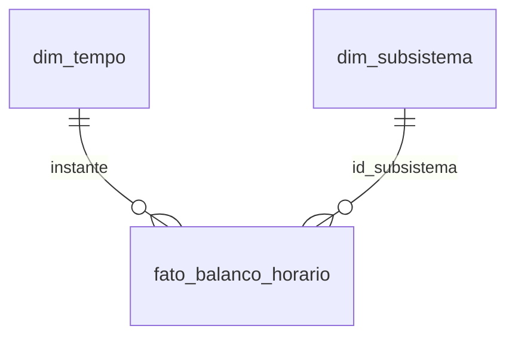
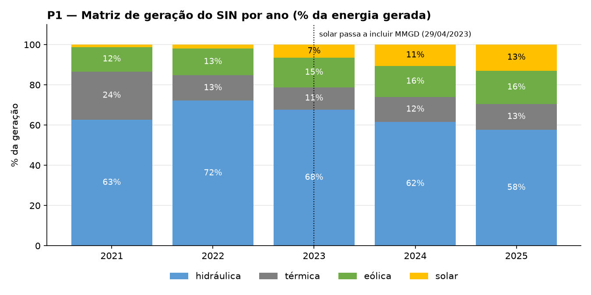
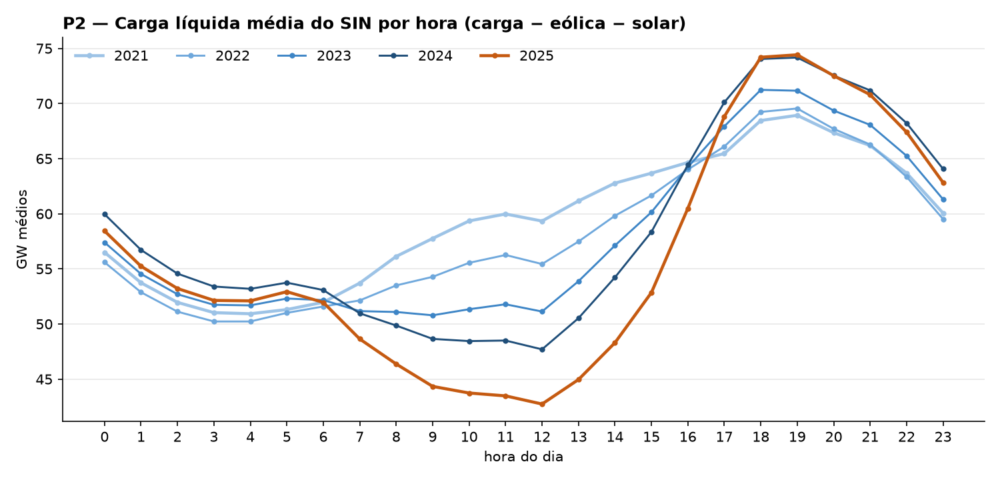
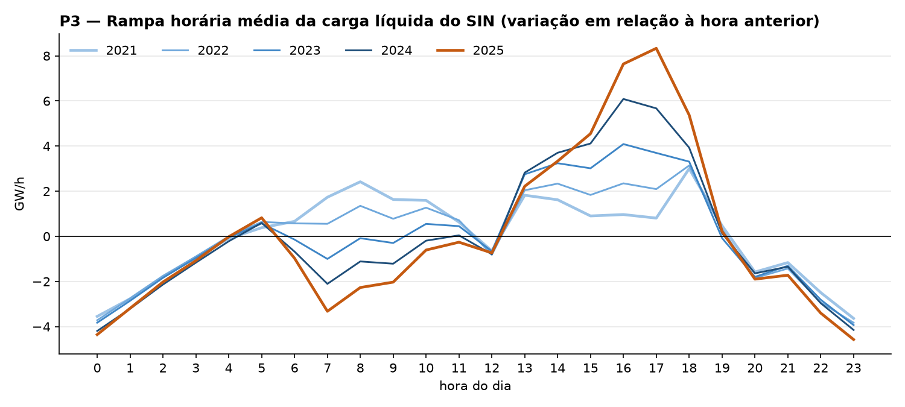
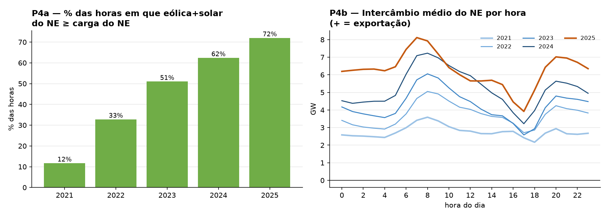
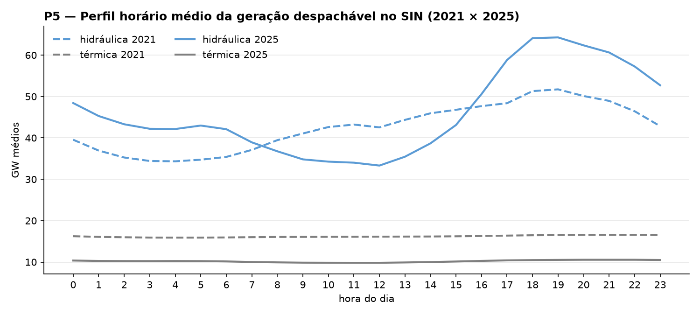
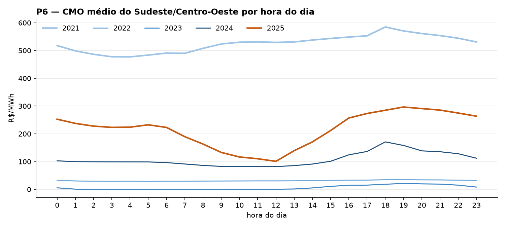

# MVP — Transição energética no SIN: carga líquida, rampas e custo marginal (2021–2025)

**Pipeline de dados em nuvem (Databricks) sobre os dados abertos do Operador Nacional do Sistema Elétrico (ONS)**

| | |
|---|---|
| **Aluna** | Gabriela Vila de Melo de Figueiredo — matrícula 231013369 |
| **Disciplina** | PSP 8 — Departamento de Engenharia de Produção / UnB |
| **Professor** | André Luiz Marques Serrano |
| **Plataforma** | Databricks Free Edition (Unity Catalog + Delta Lake) |
| **Dados** | ONS — Balanço de Energia nos Subsistemas (horário) + CMO semi-horário, 2021–2025 |

---

## Sumário
1. [Objetivo](#1-objetivo)
2. [Arquitetura do pipeline](#2-arquitetura-do-pipeline)
3. [Busca e coleta dos dados](#3-busca-e-coleta-dos-dados)
4. [Ética, licenciamento e proteção de dados](#4-ética-licenciamento-e-proteção-de-dados)
5. [Modelagem e Catálogo de Dados](#5-modelagem-e-catálogo-de-dados)
6. [Carga (ETL) e regras de negócio](#6-carga-etl-e-regras-de-negócio)
7. [Qualidade dos dados](#7-qualidade-dos-dados)
8. [Solução do problema — respostas às perguntas](#8-solução-do-problema--respostas-às-perguntas)
9. [Discussão geral](#9-discussão-geral)
10. [Autoavaliação](#10-autoavaliação)
11. [Como reproduzir](#11-como-reproduzir)
12. [Evidências](#12-evidências)
13. [Estrutura do repositório](#13-estrutura-do-repositório)
14. [Referências](#14-referências)

---

## 1. Objetivo

### 1.1 Problema
O Sistema Interligado Nacional (SIN) passa por uma mudança rápida de matriz: eólica e solar, inclusive a geração distribuída nos telhados (MMGD), crescem a cada ano. Essas fontes não são despacháveis, pois geram quando há vento e sol, e não quando há demanda. Para o operador, o que importa deixa de ser a **carga** e passa a ser a **carga líquida** (carga − eólica − solar), que é o que as usinas despacháveis (hidrelétricas e térmicas) precisam atender a cada hora.

Do ponto de vista da Engenharia de Produção, trata-se de um problema clássico de **planejamento da capacidade e do *mix* de recursos** diante de uma demanda que muda de forma. O problema deste MVP é: **como a expansão eólica e solar mudou a forma da carga líquida do SIN, quanto de flexibilidade isso exige, quem a está fornecendo e se isso já aparece no custo marginal de operação**. As respostas indicam onde investir em flexibilidade, como armazenamento, transmissão e resposta da demanda.

### 1.2 Hipótese do MVP
> **H1.** Entre 2021 e 2025, a expansão eólica e solar (i) deslocou o vale da carga líquida da madrugada para o meio-dia, criando a "curva do pato"; (ii) aumentou as rampas do fim de tarde; (iii) tornou o Nordeste exportador estrutural; (iv) foi absorvida principalmente pela flexibilidade hidrelétrica; e (v) passou a se refletir em CMO mais baixo nas horas de carga líquida baixa.

Cada item é refutável por uma pergunta abaixo.

### 1.3 Perguntas de negócio
| # | Pergunta | Decisão que apoia |
|---|---|---|
| P1 | Como evoluiu a participação de cada fonte (hidráulica, térmica, eólica, solar) na geração do SIN e de cada subsistema entre 2021 e 2025? | Diagnóstico da transição |
| P2 | Como mudou o perfil horário médio da carga líquida do SIN: hora e nível do vale e do pico, e amplitude diária? | Programação diária da operação |
| P3 | Qual é a magnitude das rampas horárias de carga líquida (média e p95 da rampa máxima diária) e em que horário ocorrem? | Dimensionamento de reserva e flexibilidade |
| P4 | Em que proporção das horas a geração eólica + solar do Nordeste supera a carga do próprio Nordeste, e quanto o subsistema exporta? | Expansão de transmissão inter-regional |
| P5 | Que fonte atende as rampas de carga líquida do fim de tarde (16 h–19 h): hidráulica ou térmica? | Valor da flexibilidade hidrelétrica e necessidade de armazenamento |
| P6 | O CMO do Sudeste/Centro-Oeste varia com a carga líquida, ou seja, é mais baixo nas horas de carga líquida baixa e mais alto no pico? | Sinal econômico para armazenamento e deslocamento de demanda |

### 1.4 Definições
* **Carga líquida (CL)** = carga − geração eólica − geração solar (MW médios na hora).
* **Rampa** = CL(h) − CL(h−1), em MW/h; a **rampa máxima diária** é a maior rampa positiva do dia.
* **Intercâmbio** > 0 significa que o subsistema exporta energia.
* **CMO** — Custo Marginal de Operação calculado pelo ONS (modelo DESSEM), em R$/MWh.

---

## 2. Arquitetura do pipeline


| Notebook | Etapa |
|---|---|
| [`00_setup.py`](notebooks/00_setup.py) | Cria schema `workspace.mvp_energia` e volume `raw` |
| [`01_coleta.py`](notebooks/01_coleta.py) | Baixa os 10 arquivos do bucket público do ONS e grava `log_coleta.json` |
| [`02_etl_bronze_silver_gold.py`](notebooks/02_etl_bronze_silver_gold.py) | ETL em três camadas (Delta), conciliação balanço × CMO, PK/FK |
| [`03_qualidade.py`](notebooks/03_qualidade.py) | Perfil por atributo e regras de qualidade |
| [`04_analise.py`](notebooks/04_analise.py) | Consultas SQL que respondem P1–P6 |

Os notebooks estão em formato *source* do Databricks e podem ser importados diretamente. O script [`scripts/pipeline_local.py`](scripts/pipeline_local.py) aplica as mesmas regras com DuckDB e gera os gráficos de [`evidencias/graficos`](evidencias/graficos) e as tabelas de [`resultados`](resultados).

---

## 3. Busca e coleta dos dados

**Por que estas bases.** O *Balanço de Energia nos Subsistemas* é a única base aberta que traz, hora a hora e no mesmo arquivo, a geração por fonte, a carga e o intercâmbio de cada subsistema. É exatamente o necessário para calcular a carga líquida e verificar o fechamento do balanço. O *CMO semi-horário* é o sinal econômico da operação no mesmo grão temporal. Ambos são publicados pelo ONS em um bucket público, com download direto e sem necessidade de *scraping*.

| Fonte | Conteúdo | Coleta | Volume | Formato |
|---|---|---|---|---|
| [ONS — Balanço de Energia nos Subsistemas](https://dados.ons.org.br/dataset/balanco-energia-subsistema) | Geração hidráulica, térmica, eólica, solar, carga e intercâmbio por subsistema e hora | 21/10/2026 | 5 arquivos (2021–2025) · 23,4 MB · 219.120 linhas | CSV `;`, UTF-8 |
| [ONS — CMO semi-horário](https://dados.ons.org.br/dataset/cmo-semi-horario) | CMO por subsistema a cada 30 min | 21/10/2026 | 5 arquivos (2021–2025) · 12,7 MB · 343.488 linhas | CSV `;`, UTF-8 |

O período 2021–2025 cobre cinco anos completos e contrastantes: crise hídrica (2021), anos úmidos (2022–2023) e a fase de expansão acelerada da solar (2024–2025). O log com URL, tamanho e data de cada arquivo é gravado em `raw/log_coleta.json` (cópia local em [`resultados/log_coleta.json`](resultados/log_coleta.json)). [`scripts/coletar.py`](scripts/coletar.py) é o plano B para *upload* manual.

---

## 4. Ética, licenciamento e proteção de dados

* **Licença dos dados:** ambos os conjuntos são publicados pelo ONS sob **Creative Commons Atribuição (CC-BY)**, conforme os metadados do portal `dados.ons.org.br`. A licença permite redistribuição e uso derivado com atribuição. Mesmo assim, para manter o repositório leve e sempre alinhado à fonte oficial, os brutos **não são versionados** (ver `.gitignore`): publica-se o script de coleta.
* **Dados pessoais (LGPD):** não há. Os dados são agregados por subsistema elétrico.
* **Dados corporativos:** não utilizados.
* **Licença do código:** MIT ([LICENSE](LICENSE)).

---

## 5. Modelagem e Catálogo de Dados

Modelo **estrela** com uma fato no grão *subsistema × hora* e duas dimensões. O CMO, originalmente semi-horário, é conciliado ao grão horário antes da junção. Diagrama e justificativas (remoção da linha SIN, fato larga) em [`catalogo/modelo_estrela.md`](catalogo/modelo_estrela.md).



O **Catálogo de Dados** completo, com tipo, descrição, domínio observado por subsistema, significado do nulo e linhagem de cada atributo, está em [`catalogo/catalogo_dados.md`](catalogo/catalogo_dados.md).

---

## 6. Carga (ETL) e regras de negócio

| Camada | Tabela | Linhas |
|---|---|---|
| bronze | `bronze_balanco` / `bronze_cmo` | 219.120 / 343.488 |
| silver | `silver_balanco` (sem SIN) | 175.296 |
| silver | `silver_cmo_horario` | 171.744 |
| gold | `fato_balanco_horario` | 175.296 |
| gold | `dim_subsistema` / `dim_tempo` | 4 / 43.824 |

| Regra | Camada | Descrição | Efeito |
|---|---|---|---|
| R1 | silver | Tipagem (TIMESTAMP, DOUBLE) e deduplicação por (subsistema, instante) | 0 duplicatas encontradas |
| R2 | silver | Remove a linha `SIN`, que é a soma dos 4 subsistemas; o SIN é recalculado por soma | Evita contagem dupla (219.120 → 175.296) |
| R3 | silver | `flag_solar_noturno` se solar > 100 MW entre 0 h e 4 h | 252 linhas em 52 dias, retiradas dos perfis horários |
| R4 | silver | `periodo_com_mmgd` = instante ≥ 29/04/2023 | Permite comparar séries de solar e carga dentro do mesmo regime |
| R5 | silver | Dia com solar ausente: soma solar das 10 h–14 h < 10% da mediana do mês | Nenhum dia encontrado (regra mantida como controle) |
| R6 | silver | CMO semi-horário → horário pela média das duas meias-horas; marca CMO negativo | Conciliação de granularidade entre as duas fontes |
| R7 | gold | Junção balanço × CMO por (subsistema, hora), `LEFT JOIN` sem imputação | 3.552 linhas (37 dias) sem CMO ficam nulas |
| — | gold | Medidas derivadas: geração total, variável (eólica + solar), carga líquida e resíduo do balanço | Base dos indicadores |

---

## 7. Qualidade dos dados

Notebook [`03_qualidade.py`](notebooks/03_qualidade.py); tabelas em [`resultados/qualidade_*.csv`](resultados).

### 7.1 Perfil por atributo (bronze)

| Tabela | Atributo | Nulos | Não numéricos | Distintos | Mín. | Máx. |
|---|---|---|---|---|---|---|
| balanço | `id_subsistema` | 0 | — | 5 | N | SIN |
| balanço | `din_instante` | 0 | — | 43.824 | 2021-01-01 00:00 | 2025-12-31 23:00 |
| balanço | `val_gerhidraulica` | 0 | 0 | 218.747 | 275,3 | 87.875,7 |
| balanço | `val_gertermica` | 0 | 0 | 217.253 | 19,0 | 22.751,1 |
| balanço | `val_gereolica` | 0 | 0 | 176.396 | 0,0 | 25.064,8 |
| balanço | `val_gersolar` | 0 | 0 | 117.059 | 0,0 | 42.551,7 |
| balanço | `val_carga` | 0 | 0 | 218.642 | 1.364,3 | 106.148,7 |
| balanço | `val_intercambio` | 0 | 0 | 193.127 | −16.172,0 | 14.146,5 |
| CMO | `id_subsistema` | 0 | — | 4 | N | SE |
| CMO | `din_instante` | 0 | — | 85.872 | 2021-01-01 00:00 | 2025-12-31 23:30 |
| CMO | `val_cmo` | 0 | 0 | 72.550 | −39,24 | 11.505,02 |

Máximos de geração e carga acima referem-se à linha agregada SIN. Os domínios por subsistema estão no catálogo.

### 7.2 Regras verificadas

| Dimensão | Regra | Ocorrências | Tratamento |
|---|---|---|---|
| Unicidade | (subsistema, instante) duplicado — balanço / CMO | 0 / 0 | — |
| Completude | Horas faltantes no balanço (esperadas 4 × 43.824) | 0 | — |
| Completude | Horas sem CMO após a junção | **3.552** (37 dias inteiros, 17 deles em dez/2022–jan/2023) | Nulo mantido; análises de CMO usam só horas com valor |
| Consistência | SIN ≠ soma dos subsistemas (carga) | 0 | Valida R2 |
| Consistência | \|geração − carga − intercâmbio\| > 500 MW | 24 (Sul, 14/09/2022, dia inteiro) | Mantido; dia isolado |
| Conformidade | Geração ou carga negativa | 0 | — |
| Acurácia | Solar > 100 MW entre 0 h e 4 h | 252 linhas / 52 dias (pico em 10/11/2024) | R3, excluídas dos perfis |
| Acurácia | Dia com solar ausente ao meio-dia | 0 | R5 |
| Acurácia | Horas com CMO negativo | 292 (mín. −39,24 R$/MWh) | Mantidas (efeito numérico do modelo; peso desprezível na média) |
| **Consistência temporal** | **Quebra de nível da série solar em 29/04/2023** | **1** | **R4 (ver 7.3)** |

### 7.3 Quebra metodológica de 29/04/2023 (achado principal de qualidade)

A série solar do SIN salta de cerca de 6 GW para 15 GW de máximo diário **de um dia para o outro**, em 29/04/2023, algo fisicamente impossível como expansão real. Comparando 14 dias antes e depois:

| Janela | Solar médio | Carga média | Carga líquida média |
|---|---|---|---|
| antes (15–28/04/2023) | 1.971 MW | 68.750 MW | 59.672 MW |
| depois (29/04–12/05/2023) | 4.924 MW | 70.988 MW | 58.175 MW |

Solar e carga sobem juntos, e a carga líquida fica estável. Isso é compatível com a **incorporação da estimativa de micro e minigeração distribuída (MMGD) à carga e à geração solar** pelo ONS, mudança discutida na revisão dos Procedimentos de Rede de 2023. Consequências para a análise:
* As **participações de solar e de carga** antes e depois de 29/04/2023 não são comparáveis diretamente (P1). A comparação limpa é 2024 × 2025.
* A **carga líquida não é afetada**, porque a MMGD entra somando na carga e subtraindo na solar. P2, P3 e P5 podem comparar 2021 a 2025 sem viés metodológico. Esse resultado foi verificado empiricamente na tabela acima.

**Conclusão de qualidade.** A base é completa e internamente consistente: o balanço fecha e o agregado SIN confere. Os pontos de atenção são a quebra metodológica de 2023, que é contornada usando carga líquida, as 37 lacunas diárias de CMO e 52 dias com solar noturno espúrio, ambos tratados.

---

## 8. Solução do problema — respostas às perguntas

### P1 — Matriz de geração



| Ano | Geração média | Hidráulica | Térmica | Eólica | Solar | **Eólica + solar** |
|---|---|---|---|---|---|---|
| 2021 | 67,9 GW | 62,7% | 23,9% | 12,2% | 1,3% | **13,4%** |
| 2022 | 69,4 GW | 72,1% | 12,6% | 13,4% | 2,0% | **15,4%** |
| 2023 | 74,5 GW | 67,7% | 11,1% | 14,6% | 6,6%\* | **21,2%** |
| 2024 | 79,1 GW | 61,6% | 12,3% | 15,5% | 10,6% | **26,0%** |
| 2025 | 80,0 GW | 57,7% | 12,8% | 16,5% | 13,1% | **29,6%** |

\* A partir de 29/04/2023 a solar inclui a MMGD.

| Eólica + solar por subsistema | 2021 | 2025 |
|---|---|---|
| Nordeste | 56,0% | **79,5%** |
| Sul | 8,6% | 17,6% |
| Sudeste/Centro-Oeste | 0,7% | 13,8% |
| Norte | 1,8% | 7,6% |

**Discussão.** Em 2025, **quase 30%** da energia do SIN veio de eólica e solar, contra 13% em 2021. Parte do salto de 2023 é metodológica (MMGD), mas a comparação 2024 → 2025, feita dentro do mesmo regime, ainda mostra +3,6 p.p. em um único ano. A térmica caiu de 24% para 13%, mas 2021 foi um ano de crise hídrica com despacho térmico excepcional. De 2022 a 2025 a térmica fica estável em 11–13%, ou seja, a renovável variável vem tomando espaço principalmente da **hidráulica** (72% → 58%). O Nordeste já gera quatro quintos da sua energia com vento e sol. No Sudeste, a solar (13,6%) é praticamente toda MMGD e usinas fotovoltaicas, já que a eólica é irrelevante lá.

### P2 — Curva de carga líquida



| Ano | Hora do vale | Vale | Hora do pico | Pico | Amplitude | Vale / pico |
|---|---|---|---|---|---|---|
| 2021 | 4 h | 50,9 GW | 19 h | 68,9 GW | 18,0 GW | 73,9% |
| 2022 | 4 h | 50,2 GW | 19 h | 69,5 GW | 19,3 GW | 72,2% |
| 2023 | 9 h | 50,8 GW | 18 h | 71,2 GW | 20,4 GW | 71,3% |
| 2024 | **12 h** | 47,7 GW | 19 h | 74,2 GW | 26,5 GW | 64,3% |
| 2025 | **12 h** | **42,7 GW** | 19 h | **74,4 GW** | **31,7 GW** | **57,4%** |

**Discussão.** A "curva do pato" já existe no Brasil. Em 2021 a carga líquida seguia a carga, com vale de madrugada e pico às 19 h. Em 2025 o vale passou para o **meio-dia**, 8 GW abaixo do de 2021, enquanto o pico das 19 h subiu 5,5 GW. A **amplitude diária cresceu 76%** (18,0 → 31,7 GW). A carga bruta não mudou de forma: o vale continua às 4 h e o pico às 19 h nos cinco anos. Logo, toda a mudança vem da geração variável: ao meio-dia de 2025, eólica + solar entregam 37,9 GW em média, contra 9,3 GW em 2021. Como a carga líquida é imune à quebra da MMGD (seção 7.3), essa comparação 2021 × 2025 é válida.

### P3 — Rampas



| Ano | Rampa máx. diária (média) | p95 | Maior rampa do ano | Hora mais frequente | % dias com rampa máx. entre 16 h e 19 h |
|---|---|---|---|---|---|
| 2021 | 4,4 GW/h | 7,3 GW/h | 9,2 GW/h | 18 h | 55,9% |
| 2022 | 4,4 GW/h | 7,4 GW/h | 8,5 GW/h | 18 h | 58,9% |
| 2023 | 5,5 GW/h | 9,0 GW/h | 11,1 GW/h | 17 h | 66,3% |
| 2024 | 7,1 GW/h | 10,5 GW/h | 13,1 GW/h | 16 h | 82,2% |
| 2025 | **9,2 GW/h** | **13,1 GW/h** | **15,6 GW/h** | 17 h | **90,7%** |

**Discussão.** A rampa máxima diária **dobrou** em quatro anos: de 4,4 para 9,2 GW/h. É como acrescentar, em uma única hora, cerca de 80% da potência instalada de Belo Monte (11,2 GW), todos os dias. Ela também ficou **previsível**: em 91% dos dias de 2025 ocorre entre 16 h e 19 h, quando a solar sai. Em 2021, a rampa média das 16 h e das 17 h era de cerca de 1 GW/h; em 2025, é de 7,6 e 8,3 GW/h. Para o planejamento, isso significa que a necessidade de flexibilidade é **concentrada e programável**, o que favorece soluções de armazenamento de 3 a 4 horas (baterias, usinas reversíveis) e de deslocamento de demanda para o meio-dia.

### P4 — Nordeste



| Ano | % horas em que eólica + solar ≥ carga do NE | % horas exportando | Intercâmbio médio | Exportação máxima | Eólica + solar / carga |
|---|---|---|---|---|---|
| 2021 | 11,7% | 75,3% | +2,8 GW | 9,7 GW | 69,6% |
| 2022 | 32,8% | 88,4% | +3,7 GW | 11,8 GW | 83,7% |
| 2023 | 51,0% | 87,7% | +4,3 GW | 13,0 GW | 97,6% |
| 2024 | 62,4% | 85,6% | +5,2 GW | 13,1 GW | 107,6% |
| 2025 | **72,0%** | **92,9%** | **+6,3 GW** | 13,6 GW | **117,0%** |

**Discussão.** O Nordeste é hoje **exportador estrutural**. Em 72% das horas de 2025, só vento e sol já bastavam para atender toda a carga da região, e em energia anual eles somam 117% da carga. A exportação média mais que dobrou (+2,8 → +6,3 GW). Ao mesmo tempo, a **exportação máxima quase não cresce desde 2023** (13,0 → 13,6 GW), enquanto a média continua subindo. Isso indica que a capacidade de escoamento para o Sudeste está se tornando a restrição ativa: o sistema exporta mais horas no teto, e não mais potência. O perfil horário (P4b) mostra o pico de exportação às 7–8 h (vento noturno forte somado à solar nascente) e a queda às 17 h, quando a solar some e a carga local sobe. Há, portanto, um argumento direto para **expansão da transmissão NE → SE**. Os dados de *curtailment* (*constrained-off*) do ONS seriam o próximo passo para confirmar essa leitura (ver autoavaliação).

### P5 — Quem atende a rampa do fim de tarde



| Ano | Rampa média (16–19 h, horas de subida) | Atendida por hidráulica | por térmica | Correlação Δhidráulica × ΔCL |
|---|---|---|---|---|
| 2021 | 2,7 GW/h | 96,5% | 3,3% | 0,992 |
| 2022 | 3,0 GW/h | 99,3% | 0,7% | 0,997 |
| 2023 | 3,7 GW/h | 99,0% | 1,3% | 0,994 |
| 2024 | 4,8 GW/h | 94,1% | 3,9% | 0,974 |
| 2025 | 6,5 GW/h | 98,3% | 1,6% | 0,997 |

**Discussão.** As **hidrelétricas atendem praticamente toda a rampa** (94–99%), com correlação próxima de 1. A térmica opera quase "flat", pois é despachada por inflexibilidade contratual ou por segurança e não acompanha a curva. O gráfico mostra o custo disso: em 2025, a geração hidráulica média cai para 33 GW ao meio-dia e sobe para 64 GW às 19 h, uma **excursão diária de 31 GW**, contra 9 GW em 2021. O SIN está usando os reservatórios como uma grande bateria. Isso funciona enquanto há água e capacidade de turbinamento nas horas de pico. Em um ano seco, ou com restrições ambientais de vazão mínima e máxima, essa flexibilidade encolhe, o que reforça o valor de armazenamento complementar.

### P6 — CMO × carga líquida



| Ano | CMO médio SE | Correlação de Pearson (CL × CMO) | Spearman |
|---|---|---|---|
| 2021 | 525,2 R$/MWh | −0,179 | −0,157 |
| 2022 | 31,4 | −0,024 | 0,042 |
| 2023 | 6,6 | 0,217 | 0,343 |
| 2024 | 107,7 | −0,004 | −0,152 |
| 2025 | 216,0 | **0,315** | **0,395** |

| 2025 — quintil de carga líquida | CL (GW) | CMO mediano SE |
|---|---|---|
| 1 (mais baixa, meio-dia) | 31,0–43,2 | **7,4 R$/MWh** |
| 2 | 43,3–49,5 | 273,1 |
| 3 | 49,5–59,7 | 283,6 |
| 4 | 59,7–68,7 | 284,2 |
| 5 (mais alta, fim de tarde) | 68,7–92,5 | 284,9 |

**Discussão.** Resposta **parcial e dependente do ano**. O nível do CMO é dominado pela **hidrologia**: 525 R$/MWh na crise hídrica de 2021 e cerca de 0 em 2023, um ano de vertimento. De 2021 a 2024 a relação horária entre carga líquida e CMO é fraca ou inexistente. Em **2025**, porém, surge um sinal claro: nas 20% horas de menor carga líquida, o CMO mediano é de **R$ 7/MWh**, contra cerca de R$ 280 nos demais quintis, e o perfil horário médio vai de R$ 101 ao meio-dia a R$ 297 às 19 h. A forma não é linear: o preço "desaba" quando há excedente renovável e fica no patamar do custo térmico no resto do dia. Essa diferença intradiária é exatamente o que remunera armazenamento e deslocamento de carga. Como é observada em um único ano, ela ainda precisa ser confirmada em 2026.

---

## 9. Discussão geral

| Item da hipótese H1 | Veredito | Evidência |
|---|---|---|
| (i) Vale da CL migrou para o meio-dia | **Confirmado** | Vale às 4 h (2021) → 12 h (2025); amplitude +76% |
| (ii) Rampas do fim de tarde aumentaram | **Confirmado** | Rampa máxima diária média 4,4 → 9,2 GW/h; 91% dos dias entre 16 h e 19 h |
| (iii) NE exportador estrutural | **Confirmado** | Exporta em 93% das horas; renovável variável = 117% da carga |
| (iv) Flexibilidade vem da hidráulica | **Confirmado** | 94–99% da rampa; excursão diária de 31 GW em 2025 |
| (v) CMO menor nas horas de CL baixa | **Parcial** | Só em 2025 (Spearman 0,40; CMO mediano de R$ 7 no 1º quintil) |

**Leitura de Engenharia de Produção.** O SIN migrou de um problema de **volume** (há energia suficiente no ano?) para um problema de **forma e sequenciamento** (há potência flexível na hora certa?). A demanda líquida ficou mais "pontuda" e previsível: o gargalo está em 2 a 3 horas do fim de tarde, todos os dias, e hoje é coberto quase só pelas hidrelétricas, que são um recurso limitado pela hidrologia. As alavancas, em ordem de evidência, são:
1. **Armazenamento** de 3 a 4 h (baterias e usinas reversíveis) para transferir o excedente do meio-dia para a rampa das 17–19 h.
2. **Transmissão NE → SE**, dado o teto aparente de exportação de cerca de 13 GW.
3. **Sinal de preço horário** ao consumidor (tarifa branca, resposta da demanda), que em 2025 começa a ter fundamento no CMO.

---

## 10. Autoavaliação

**1. Perguntas respondidas e não respondidas.** P1 a P5 foram respondidas com evidência direta. P6 foi respondida apenas parcialmente: a relação entre CMO e carga líquida só aparece em 2025, e nos outros anos o efeito da hidrologia domina. Separar os dois efeitos exigiria controlar pelo armazenamento dos reservatórios (EAR), o que não foi feito. P1 também teve resposta limitada para a solar entre 2021 e 2023 por causa da quebra metodológica.

**2. Limitações dos dados.**
* A inclusão da MMGD a partir de 29/04/2023 impede comparar participações de solar e carga entre os dois regimes. Contornei isso usando a carga líquida.
* A MMGD é **estimada** pelo ONS, e não medida.
* O balanço não traz ***curtailment***: não sei quanto de eólica e solar foi cortado por restrição de rede. Por isso a conclusão sobre o teto de exportação do NE é inferencial.
* As médias horárias escondem a variabilidade intra-horária.
* O CMO é uma variável de modelo (DESSEM), não um preço de mercado (o PLD tem piso e teto regulatórios).
* Há 37 dias sem CMO publicado.

**3. O que faria diferente.**
* Incluiria desde o início a base de **restrição de operação por *constrained-off*** de eólicas e fotovoltaicas do ONS, para medir o curtailment e fechar a pergunta sobre transmissão.
* Incluiria a **EAR** (energia armazenada) para controlar o efeito hidrológico em P6.
* Começaria a análise pela qualidade da série solar: só percebi a quebra de 2023 ao ver o salto no gráfico de P1, e tive de voltar ao ETL para criar a R4.

**4. Extensões para uso contínuo.**
* Agendar a coleta diária via *Databricks Jobs* (o ONS atualiza os arquivos do ano corrente) com carga incremental por `MERGE`.
* Acrescentar curtailment, EAR e PLD como novas fatos que compartilham `dim_tempo` e `dim_subsistema` (constelação de fatos).
* Montar um painel de "termômetro da flexibilidade", com rampa máxima do dia, excursão hidráulica e exportação NE, e regras de qualidade automáticas (*expectations*) para detectar novas quebras de série.

---

## 11. Como reproduzir

**No Databricks (Free Edition):**
1. Crie uma conta em https://www.databricks.com/learn/free-edition.
2. *Workspace › Import* → importe os 5 arquivos de [`notebooks/`](notebooks) (ou conecte o repositório em *Git folders*).
3. Execute, nesta ordem, `00_setup` → `01_coleta` → `02_etl_bronze_silver_gold` → `03_qualidade` → `04_analise` (Serverless).
4. Sem acesso à internet no cluster: rode `python scripts/coletar.py` localmente e envie `dados/para_upload/balanco/*` e `dados/para_upload/cmo/*` para as pastas `balanco/` e `cmo/` do volume `workspace.mvp_energia.raw`.

**Localmente (mesmas regras, DuckDB):**
```bash
pip install -r requirements.txt
python scripts/pipeline_local.py
```

---

## 12. Evidências

Os notebooks foram executados na Databricks Free Edition (Serverless, schema `workspace.mvp_energia`). Os resultados de cada etapa podem ser conferidos em:

| Evidência | Arquivo |
|---|---|
| Log da coleta (URL, tamanho e data de cada arquivo) | [`resultados/log_coleta.json`](resultados/log_coleta.json) |
| Contagem de linhas por camada | [`resultados/contagem_camadas.csv`](resultados/contagem_camadas.csv) |
| Regras de qualidade e quebra da MMGD | [`resultados/qualidade_regras.csv`](resultados/qualidade_regras.csv) · [`resultados/qualidade_quebra_mmgd.csv`](resultados/qualidade_quebra_mmgd.csv) |
| Gráficos das respostas P1–P6 | [`evidencias/graficos/`](evidencias/graficos) |
| Tabelas das respostas P1–P6 (CSV) | [`resultados/`](resultados) |

Para verificar a persistência na nuvem, basta reexecutar os notebooks (seção 11) e consultar `workspace.mvp_energia` no Catalog Explorer. As contagens devem coincidir com [`contagem_camadas.csv`](resultados/contagem_camadas.csv).

---

## 13. Estrutura do repositório

```
├── README.md                 este documento
├── LICENSE                   MIT (código) + registro da licença dos dados
├── requirements.txt
├── notebooks/                00_setup … 04_analise (Databricks source)
├── scripts/                  coletar.py · pipeline_local.py
├── catalogo/                 catalogo_dados.md · modelo_estrela.md
├── evidencias/
│   └── graficos/             gráficos das respostas
└── resultados/               tabelas CSV de qualidade e de cada pergunta
```

---

## 14. Referências

* ONS. *Dados Abertos — Balanço de Energia nos Subsistemas*. https://dados.ons.org.br/dataset/balanco-energia-subsistema
* ONS. *Dados Abertos — Custo Marginal de Operação semi-horário*. https://dados.ons.org.br/dataset/cmo-semi-horario
* ONS. *Procedimentos de Rede*, submódulos 3.5 e 4.4 — revisão para inclusão da MMGD na consolidação da previsão de carga (consulta pública, 2023).
* ABRACEEL. *Contribuição à revisão dos Procedimentos de Rede para inclusão da MMGD no processo de consolidação da previsão de carga*, fev. 2023.
* BRASIL. Lei nº 14.300/2022 — Marco legal da micro e minigeração distribuída.
* BRASIL. Lei nº 13.709/2018 — Lei Geral de Proteção de Dados (LGPD).
* SERRANO, A. L. M. *MVP — Minimum Viable Product: apresentação, requisitos e critérios de avaliação*. Departamento de Engenharia de Produção, UnB.
