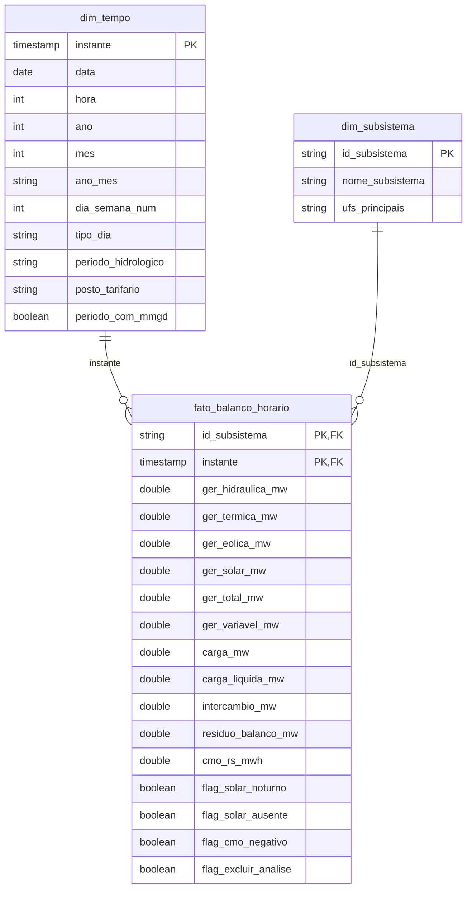

# Modelo de dados — esquema estrela

**Grão.** Uma linha por subsistema e hora. A chave é composta por (`id_subsistema`, `instante`).

**Conciliação de duas fontes.** O balanço é horário e o CMO é semi-horário. O CMO foi agregado para a hora pela média das duas meias-horas (`silver_cmo_horario`) antes da junção, para que ambos fiquem no mesmo grão. A junção é `LEFT`: horas sem CMO publicado continuam na fato com `cmo_rs_mwh` nulo.

**Por que a linha "SIN" foi removida.** No arquivo do ONS, o SIN é a soma dos quatro subsistemas; mantê-lo na fato duplicaria toda a energia em qualquer agregação. O SIN é recalculado por soma na view `v_sin`, e a identidade SIN = Σ subsistemas é verificada na etapa de qualidade.

**Por que fato larga, e não uma linha por fonte.** As perguntas comparam fontes na mesma hora (ex.: Δhidráulica × Δcarga líquida). Com as fontes em colunas, essas comparações não precisam de *pivot*. Uma `dim_fonte` com a fato em formato longo seria a evolução natural se entrassem mais fontes (nuclear separada, biomassa, importação).
